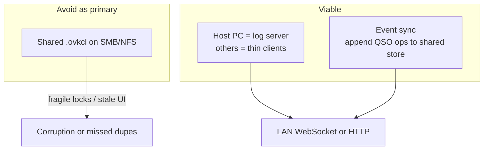

# Multi-station shared logging (post v1.0)

Design note for running OpenVKCL on several PCs against **one** contest log.
Typical use: multi-op field day or club station, each PC on a **different band**.

Not scheduled for implementation before v1.0.

## What we have today

- One `.ovkcl` SQLite file, opened by a single process ([`src-tauri/src/store.rs`](../src-tauri/src/store.rs)).
- QSOs are loaded into memory (`OpenLog.qsos`); scoring and dupes are recomputed in Rust on each change ([`src-tauri/src/contest/engine.rs`](../src-tauri/src/contest/engine.rs)).
- No multi-writer, no sync, and no station identity beyond the QSO `operator` field.

Putting the file on a network share and opening it from two PCs will not work reliably (locking, stale in-memory state, serial races).

## Contest reality

| Concern | Different bands | Same band |
| --- | --- | --- |
| Dupes / rework | Usually independent | Must see each other’s QSOs live |
| Serials | Often per-band already | One series needs a single allocator |
| Score | Needs the full combined log | Same |
| Rig | Per PC | Per PC |

Design for **multi-op, multi-band first**; same-band is the harder edge case.

## Options

### 1. Shared file on a network drive — not the main design

SQLite over SMB/NFS is a known footgun. Possible only as a desperate “export only” path, not for live multi-op.

### 2. Host / clients on the LAN — best fit for OpenVKCL

- One PC **owns** the `.ovkcl` (or runs a small local service).
- Other PCs connect as clients: log QSOs, receive score/dupe updates, keep their own radio link.
- The host runs the existing contest engine; clients are UI + rig + “submit QSO”.

**Pros:** one writer, correct serials/dupes/score, reuses today’s model.  
**Cons:** host must stay up; need discovery (e.g. mDNS) and basic LAN auth.

### 3. Peer sync of QSO events — more flexible, more work

Each PC writes locally; append-only events merge (by id/time). The engine re-runs on the merged set.

**Pros:** no single host.  
**Cons:** serial allocation and conflict UX get hard; overkill if one shack PC can be the host.

## Recommended direction

**LAN host + clients**, with these rules:

1. **Open** — “Share this log on the LAN” on the host; others “Join shared log…”.
2. **Writes** — only the host inserts/updates/deletes; clients send commands.
3. **Reads** — host pushes log version / delta (aligned with sending less of the log to the UI).
4. **Serials** — host allocates; per-band serial contests stay simple; a global series stays consistent.
5. **Operator** — each client sets an operator call; stamped on QSOs.
6. **Band** — each client follows its own radio; UI can highlight “your band” vs the full log.
7. **Offline** — if the host drops, clients queue or go read-only (decide explicitly when building).

## What not to do early

- Don’t make “shared folder `.ovkcl`” the product promise.
- Don’t split into one file per band and merge only at Cabrillo time — live dupes and score suffer.
- Don’t require cloud or internet for a field-day LAN.

## Phases after v1.0

1. **Doc + spike** — host command API: `log_qso` / `get_view` over localhost, then LAN.
2. **MVP** — two clients, different bands, live dupes + serials + score; operator field.
3. **Hardening** — reconnect, host failover story, same-band warnings, setup locked to the host.
4. **Optional** — read-only “scoreboard” tablet.

## Open decisions (when this is picked up)

- UDP/mDNS discovery vs paste `host:port`.
- Whether setup (categories, sent exchange) is host-only.
- Whether clients may edit/delete any QSO or only their own.
- Cabrillo/ADIF only from the host, or from any client as a pull.
