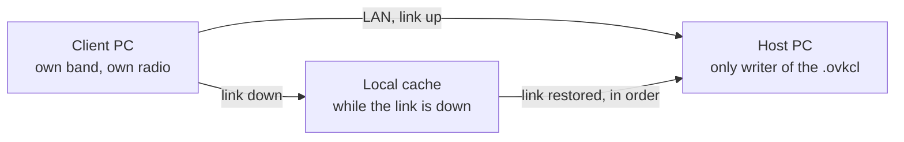

# Multi-station shared logging

Design note for running OpenVKCL on several PCs against **one** contest log.
Typical use: multi-op field day or club station. Each PC logs on a **different band**.
The PC that opens the log is the host. Other PCs join it on the LAN.

## Decided

- The link is on the LAN. Field day does not need the internet.
- The host is the app that opens the log. New log and Open log make this PC the host, and it is the only process that writes the `.ovkcl`. Closing the log stops hosting.
- A client joins that open log and does not open a file. Clients log, follow their own radio, and send contacts to the host.
- Setup stays on the host: contest, categories, sent exchange, and generic options. Clients use that setup and do not change it.
- A client can edit contacts on its own band. The host writes the change. A client cannot edit contacts on another station's band.
- One station per band. A client cannot use a band the host or another client is already logging. The host cannot select a band a client is logging on. That includes the band control and the radio moving onto a taken band. A band stays taken while that station is joined, including across a dropped link. Leaving the shared log releases it.
- If the link drops, the client keeps new contacts locally and sends them, in order, when the connection returns. The host allocates serials, applies the contest's dupe rules, and writes the file. The client does not write an `.ovkcl`.

## What we have today

- One `.ovkcl` SQLite file, opened by a single process ([`src-tauri/src/store.rs`](../src-tauri/src/store.rs)).
- QSOs are loaded into memory (`OpenLog.qsos`); scoring and dupes are recomputed in Rust on each change ([`src-tauri/src/contest/engine.rs`](../src-tauri/src/contest/engine.rs)).
- Serials are the highest number already in that memory, plus one, per band when the contest says so (`next_sent_nr` in [`src-tauri/src/commands.rs`](../src-tauri/src/commands.rs)).
- The per-contact `operator` column exists, but logging stores it blank. `Station.operators` is only the Cabrillo header list.
- `view()` sends every row to the UI.

Putting the file on a network share and opening it from two PCs will not work reliably (locking, stale in-memory state, serial races).

## How a contact is logged

| Concern | Rule |
| --- | --- |
| Role | The app that opens the `.ovkcl` is the host. Join does not open a file. |
| Band | One station per band. A client cannot take a band the host or another client is using, and the host cannot take a client's band. |
| Dupes | The host sees the combined log. A contact cached while offline is checked when the host writes it. |
| Serials | The host assigns the number when it writes, including contacts that waited in a client cache. |
| Score | The host holds the combined log and runs the contest engine. |
| Rig | Each PC keeps its own radio connection. |
| Operator | Each client sets an operator call; the host stamps it on that client's contacts. |
| Edits | A client can edit contacts on its band. The host writes the change. |

A global serial series stays consistent because only the host hands out numbers. A contact cached during an outage gets the next number at the moment the host writes it, after anything logged on the other bands while the link was down.

## What not to do

- A shared folder `.ovkcl` on SMB or NFS. SQLite over those shares corrupts or misses dupes.
- One file per band, merged only at Cabrillo time. Live dupes and the score need the combined log.
- Peer sync, where every PC writes and the logs merge later. Serials and conflicts belong on the host.
- A cloud service. The LAN is the connection.

## What the app does

1. The PC that opens the log listens, and a second PC can send a contact that is written into that file.
2. One station per band, in both directions. Dupes, serials, and the score come from the host. A client keeps contacts in order while the host cannot be reached, and sends them when the same host is back.
3. A client can edit and delete contacts on its own band. Setup stays on the host. Cabrillo, ADIF, and the score sheet can be pulled.
4. A scoreboard is a client that never claims a band.

## Decided

- The open log sends a UDP beacon about once a second on port 7375, with the TCP port, contest name, and callsign. Join lists what it hears. A typed `host:port` still works when broadcasts are dropped. The TCP port is 7374 unless that port is already taken.
- A client may delete a contact on its own band. The host writes the delete. A client cannot delete another station's band.
- A client can pull Cabrillo, ADIF, and the score sheet. The host renders the text and the client saves the file. ADIF import stays on the host.
- A cached contact the host marks as a duplicate is still logged, with no points, and the client is told. A contact the host refuses is dropped from the queue and the reason is shown.
- A scoreboard joins with no band. It sees the log and cannot log or edit.
